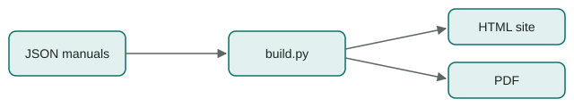
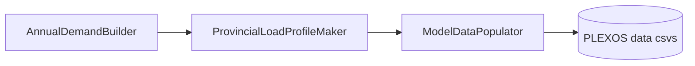

<!-- manual-md 1 | source: content/manuals/authoring-guide.json | sha256: b8c7b3f3f447de58 -->
<!-- Edit the prose freely: headings, paragraphs, list items, table cells, entry values, and the text inside the JSON of a comment line (captions, notes). Keep the front matter, every comment line and the {#id} at the end of each heading: md_to_json uses them to rebuild the JSON. A new paragraph under a heading needs nothing extra; a new list, table or other block starts with a type comment line copied from a block of the same type. A new heading needs its own {#id} (lower case, digits, hyphens). Inline markup is the manual's own: [[term]] glossary, [@#anchor] cross-reference, $`tex`$ maths, **bold**. The Contents list and the <a id> line above each heading are generated: md_to_json refreshes them, edits there are ignored. -->

---
$schema: "../../schema/manual.schema.json"
id: "authoring-guide"
title: "Authoring Guide"
subtitle: "How to write and publish a manual in this repository"
description: "Every content block and inline syntax the builder supports, with live examples. Internal: kept off the live site."
version: "1.0"
status: "final"
updated: "2026-10-22"
publish: false
order: 999
toc_depth: 2
changelog: [{"version": "1.0", "date": "2026-10-22", "changes": ["First version of the framework."]}]
---

<!-- toc -->
**Contents**

- [1 Workflow](#workflow)
- [2 Manual structure](#structure)
- [3 Inline syntax](#inline)
- [4 Content blocks](#blocks)
- [5 Glossary](#glossary-use)
- [Appendix A Publishing setup](#publishing)
<!-- /toc -->

<a id="workflow"></a>

# Workflow {#workflow}

> One JSON file per manual. The builder checks it, then renders the site and the PDF from it.

<!-- figure {"id": "fig-pipeline", "caption": "From JSON to site and PDF.", "width": "80%"} -->


<!-- list {"ordered": true} -->
1. Scaffold a manual: `python scripts/builder/build.py --new methodology "Methodology"`. It starts as a draft with `"publish": false`.
2. Write its sections in `content/manuals/methodology.json`. Your editor checks the file against `schema/manual.schema.json` as you type, through its `$schema` line.
3. Run `build.cmd`. It validates every manual, builds `site/` including drafts, prints the PDFs and opens the site.
4. When the manual is ready, set `"publish": true` and push. GitHub Actions rebuilds the live site and its PDFs.

<!-- callout {"kind": "important"} -->
The build stops on any problem: a schema error, an unknown glossary term, a broken cross-reference, a missing figure file, or a published manual linking to an unpublished one. It lists every problem with its location.

<a id="structure"></a>

# Manual structure {#structure}
<!-- section {"sources": ["schema/manual.schema.json"]} -->

<!-- text -->
A manual has metadata, `sections`, optional `appendices` (lettered A, B, …) and an optional `changelog`. Sections nest to any depth through their own `sections` array and are numbered automatically, so reordering never means renumbering. A section `id` is its permanent anchor: links use it, so keep it stable when titles change.

<!-- table {"id": "tab-meta", "caption": "Manual metadata fields."} -->
| Field | Required | Meaning |
| --- | --- | --- |
| `id` | yes | Equals the file name; used in URLs and cross-references. |
| `title`, `subtitle`, `description` | title | Shown on the page, the cover and the landing card. |
| `version`, `updated`, `status` | yes | `status` is `draft`, `review` or `final`. Drafts get a banner online and on the PDF cover. |
| `applies_to` | no | `PLEXOS`, `PyPSA` or both. Shown as badges. Sections and entries take it too. |
| `publish` | no | `false` keeps the manual off the live site. |
| `order`, `toc_depth` | no | Landing-page position; how many heading levels the contents list shows. |

<!-- text -->
A section can also carry `summary` (a lead paragraph) and `sources`, the workspace files it was written from. Sources print under the section, so a reader can see where a statement comes from.

<a id="inline"></a>

# Inline syntax {#inline}

<!-- table {"caption": "Inline markup inside any text field."} -->
| Write | Result |
| --- | --- |
| `**bold**`, `*italic*` | **bold**, *italic* |
| `` `code` `` | `MZ_Properties.csv` |
| `[text](https://…)` | [an external link](https://pypsa.org) |
| `[[snsp]]` or `[[snsp\|label]]` | [[snsp]] links to the glossary, with the definition on hover. |
| `[@#inline]` | [@#inline] (same manual, section or labelled block) |
| `[@#tab-meta]` | [@#tab-meta] |
| `[@other-manual#anchor\|label]` | A link into another manual. |
| `` $`E = P \cdot t`$ `` | $`E = P \cdot t`$ inline maths |

<!-- callout {"kind": "note", "title": "Backslashes and dollars", "_list": true} -->
JSON needs every backslash doubled, so TeX's `\frac` is written `\\frac` in the file.

Inline maths uses GitLab's `` $`…`$ `` form, so a plain `$` (as in $/kW) is never taken for maths.

<a id="blocks"></a>

# Content blocks {#blocks}

> Each entry in a section's `blocks` has a `type`. Any block may have an `id`; tables, figures, diagrams and equations are then numbered and can be cited.

<!-- text -->
`text` takes one string or an array of paragraphs. `list` takes strings or `{"text", "items"}` objects for nesting:

<!-- list -->
- A plain item
- An item with children
  - Child one
  - Child two

<!-- text -->
`entries` renders record cards, one per item, with the fields named in the block. This is the form for inputs, parameters and result variables:

<!-- entries {"fields": [{"key": "source", "label": "Source"}, {"key": "method", "label": "Method"}]} -->
- **Node hourly load** <!-- {"id": "entry-load", "applies_to": ["PLEXOS", "PyPSA"]} -->
  - source:
    - National annual demand (GWh)
    - Province load shapes and shares
  - method: Each province's shape is scaled to its share of national demand; a node is the sum of its provinces.

<!-- text -->
`equation` takes KaTeX in `tex` and an optional `where` legend:

<!-- equation {"id": "eq-energy"} -->
```math
E_{n,y} = \sum_{t \in T_y} w_t \, P_{n,t}
```

| Symbol | Meaning | Unit |
| --- | --- | --- |
| E_{n,y} | Energy at node $`n`$ in year $`y`$ | MWh |
| w_t | Weight of sampled hour $`t`$ | h |
| P_{n,t} | Power at node $`n`$ in hour $`t`$ | MW |

<!-- text -->
Cite it as [@#eq-energy]. `callout` has five kinds:

<!-- callout {"kind": "assumption"} -->
Stated modelling assumptions.

<!-- callout {"kind": "limitation"} -->
Known limitations of the method.

<!-- callout {"kind": "warning"} -->
Things that commonly go wrong.

<!-- text -->
`diagram` draws Mermaid source; `figure` shows an image from `content/assets/`, such as [@#fig-pipeline]:

<!-- diagram {"id": "fig-chain", "caption": "Demand chain, as a Mermaid diagram.", "_list": true} -->


<!-- text -->
`code` shows text as written:

<!-- code {"_list": true} -->
```json
{"type": "callout", "kind": "note",
 "text": "Short note."}
```

<a id="glossary-use"></a>

# Glossary {#glossary-use}

<!-- text {"_list": true} -->
Terms live once, in `content/glossary.json`, and every manual shares them. Reference a term as `[[id]]`. Online the term links to the glossary page, which lists the manuals that use it. Each PDF gets a *Terms used* appendix with only its own terms, so it stands on its own.

Add a term before you use it; an unknown id stops the build.

<!-- appendices -->

<a id="publishing"></a>

# Publishing setup {#publishing}

<!-- list {"ordered": true} -->
1. Create an empty GitHub repository and add it as this repo's `origin`.
2. In the repository's Settings → Pages, set Source to *GitHub Actions*.
3. Put the site address in `content/site.json` `base_url`, so links between manuals inside a PDF point to the live site.
4. Push to `main`. The workflow in `.github/workflows/pages.yml` validates, builds the site and the PDFs, and deploys them.
