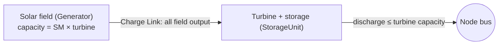

<!-- manual-md 1 | source: content/manuals/pypsa-architecture.json | sha256: 9d76597c60e78a40 -->
<!-- Edit the prose freely: headings, paragraphs, list items, table cells, entry values, and the text inside the JSON of a comment line (captions, notes). Keep the front matter, every comment line and the {#id} at the end of each heading: md_to_json uses them to rebuild the JSON. A new paragraph under a heading needs nothing extra; a new list, table or other block starts with a type comment line copied from a block of the same type. A new heading needs its own {#id} (lower case, digits, hyphens). Inline markup is the manual's own: [[term]] glossary, [@#anchor] cross-reference, $`tex`$ maths, **bold**. The Contents list, the section numbers in the headings and the <a id> line above each heading are generated: md_to_json refreshes them, edits there are ignored. -->

---
$schema: "../../schema/manual.schema.json"
id: "pypsa-architecture"
title: "PyPSA Model Architecture"
subtitle: "How the PLEXOS capacity-expansion model is represented in PyPSA"
description: "How the PyPSA benchmark represents assets, availability, corridors, trade, SNSP, CSP, energy caps, time sampling, model size and the optimisation, and where PyPSA's data model forces a different design than PLEXOS."
version: "1.1"
status: "final"
updated: "2026-11-02"
applies_to: ["PyPSA"]
publish: true
order: 20
toc_depth: 2
changelog: [{"version": "1.1", "date": "2026-11-02", "changes": ["New sections: SNSP limits, and Model size (milestone years and myopic blocks).", "Overview lists the six main efforts towards parity with PLEXOS, each linked to its section."]}, {"version": "1.0", "date": "2026-10-22", "changes": ["First published version, from PypsaExpansion/MasterDocs/ModelArchitecture_Pypsa.md."]}]
---

<!-- toc -->
**Contents**

- [1 Overview](#overview)
- [2 Where constraints live](#constraint-visibility)
- [3 Milestone-wise asset declarations](#vintages)
  - [3.1 Why PyPSA needs a different representation](#vintages-why)
  - [3.2 The vintage pattern](#vintage-pattern)
  - [3.3 Bounding the vintages](#vintage-bounds)
- [4 Availability: outage and maintenance derating](#availability)
- [5 Internodal corridors](#corridors)
  - [5.1 One two-way Link per corridor](#corridor-links)
  - [5.2 Losses: 5%, added at solve time](#corridor-losses)
  - [5.3 Token flow cost](#corridor-flow-cost)
- [6 Cross-border trade](#trade)
- [7 Unserved energy](#unserved-energy)
- [8 SNSP limits](#snsp)
- [9 Solar CSP with thermal storage](#csp)
  - [9.1 Why CSP needs two linked components](#csp-why)
  - [9.2 Turbine and solar field](#csp-components)
  - [9.3 Linking the two components](#csp-links)
  - [9.4 Bounding CSP expansion](#csp-bounds)
  - [9.5 Why these constraints are added at solve time](#csp-solve-time)
- [10 Capacity-factor energy caps](#energy-caps)
- [11 Time resolution](#time-resolution)
  - [11.1 Representative days](#time-sampling)
  - [11.2 Comparison with PLEXOS sampled chronology](#time-vs-plexos)
  - [11.3 Other PyPSA options](#time-options)
- [12 Optimisation](#optimisation)
  - [12.1 Pathway planning and the multi-period flag](#pathway-planning)
  - [12.2 Discounted objective and capital annuities](#npv)
  - [12.3 Linear programme, no unit commitment](#lp-milp)
  - [12.4 Perfect foresight and myopic planning](#foresight)
  - [12.5 Model size: milestone years and myopic blocks](#model-size)
  - [12.6 Not implemented: end-state optimisation](#overnight)
  - [12.7 Summary](#optimisation-summary)
<!-- /toc -->

<a id="overview"></a>

# 1 Overview {#overview}
<!-- section {"sources": ["PypsaExpansion/MasterDocs/ModelArchitecture_Pypsa.md"]} -->

<!-- text {"_list": true} -->
The PyPSA model is a benchmark of the PLEXOS long-term capacity-expansion model ([[lt-plan]]). It is built directly from the PLEXOS model's skeleton and data, by the V0 model creator, and keeps PLEXOS's object names wherever it can.

PyPSA's data model differs from PLEXOS's in several places: it fixes a component's capacity once for its whole life, has no market object, can't put a loss on a two-way corridor, and can express only a few constraint shapes natively. This manual explains, topic by topic, how the PyPSA model represents each part of the system, where it has to differ from PLEXOS, and how those gaps are closed.

Reaching parity with PLEXOS took six main efforts, each explained in its own section:

<!-- list {"ordered": true} -->
1. **Model size: milestone years and myopic blocks.** HiGHS can't solve all 30 years at once, so the horizon is reduced to milestone years placed where the inputs change, solved in three [[myopic|myopic]] blocks ([@#model-size]).
2. **Vintages and block persistence.** One component per candidate and milestone year, bounded together by PLEXOS's cumulative potential ([@#vintages]); what a block builds is locked in for the later blocks ([@#foresight]).
3. **Sampled chronology with peak and energy rescaling.** PLEXOS-style statistical day selection, with each node's load rescaled to the interval's input peak and energy ([@#time-resolution]).
4. **Constraints added at solve time** ([@#constraint-visibility]): [[snsp]] ([@#snsp]), the two-component CSP ([@#csp]) and the capacity-factor energy caps ([@#energy-caps]).
5. **Corridor losses, token flow cost and cross-border markets.** Each corridor split into two one-way Links ([@#corridors]); PLEXOS Markets as Generators with annual energy bounds ([@#trade]).
6. **Economics and availability.** NPV period weights and capital annuities as in the LT Plan ([@#npv]); outage and maintenance derating ([@#availability]).

<!-- callout {"kind": "note", "title": "Software versions"} -->
PyPSA 1.3.0 with linopy 0.9.1, pandas 3.0 and the HiGHS solver 1.15.1 (via `highspy`), as of 2026-10-06.

<a id="constraint-visibility"></a>

# 2 Where constraints live {#constraint-visibility}
<!-- section {"sources": ["PypsaExpansion/MasterDocs/ModelArchitecture_Pypsa.md", "My summary guides/Custom_Constraint_Export_Options.md"]} -->

> Some constraints are saved in the network file; others exist only inside a running solve. Only the first kind can be inspected afterwards with PyPSA's own tools.

<!-- entries {"fields": [{"key": "what", "label": "What it is"}, {"key": "examples", "label": "Examples"}, {"key": "visible", "label": "Visible after a solve"}]} -->
- **Constraints saved as network components**
  - what: Built with PyPSA's native [[global-constraint]] type: an ordinary row of the network's data, saved and reloaded like a `Bus` or a `Generator`.
  - examples:
    - Vintage capacity ceilings ([@#vintages])
    - CSP minimum-build floor per configuration ([@#csp])
  - visible: Yes. Exporting the network (e.g. `n.export_to_csv_folder()`) writes `global_constraints.csv` with every one of them by name, type and bound, with no solver involved.
- **Constraints built at solve time**
  - what: Shapes a GlobalConstraint can't express. They are added directly to the optimisation problem each time a solve starts, and are never registered as network components.
  - examples:
    - [[snsp]] local, global and import-cap constraints
    - CSP Charge Link, Solar Field Link and joint potential ceiling ([@#csp])
    - Capacity-factor energy caps ([@#energy-caps])
  - visible: No. The export tools only serialise components, so a saved network shows no trace of them, even where they were binding. Only their inputs are stored.

<!-- text -->
Solve-time constraints exist only in the linopy model, PyPSA's optimisation layer, which lives in memory during the solve and is discarded when the Python process ends. Linopy offers standard ways to inspect it, but none is switched on in this codebase yet:

<!-- list -->
- **Inspect the live model** in the same session as the solve. Every variable and constraint shows with its real name. This works only interactively and leaves nothing behind.
- **Write the `.lp` file with real names.** The model already exports `MatrixProblem.lp` (`make_matrix_problem` switch), which contains every constraint. However, linopy's default labels them generically (`x1`, `c2`, …), so searching it for `ChargeLink` finds nothing. Linopy can write the real names instead.
- **Save the linopy model** in linopy's own format, which keeps every variable and constraint with its name and can be reloaded without rebuilding or re-solving.
- **Export one constraint to CSV**: one row per snapshot, with columns for coefficients and right-hand side. This is the most direct way to look at a single constraint.

<a id="vintages"></a>

# 3 Milestone-wise asset declarations {#vintages}
<!-- section {"sources": ["PypsaExpansion/MasterDocs/ModelArchitecture_Pypsa.md §1"]} -->

<a id="vintages-why"></a>

## 3.1 Why PyPSA needs a different representation {#vintages-why}

<!-- text {"_list": true} -->
PLEXOS represents a candidate generator or battery as **one persistent object**. How many units are built is a decision PLEXOS can change at different points of the horizon, while `Max Units Built` and `Min Units Built` cap and floor the object's total over its whole life.

PyPSA can't do this in one object. The capacity variable `p_nom` of an extendable component is **one number, decided once, for the component's whole life**. To let a technology at a site add capacity in 2023, more in 2030 and more again in 2035, PyPSA needs one component per commissioning year: a [[vintage]].

<a id="vintage-pattern"></a>

## 3.2 The vintage pattern {#vintage-pattern}

<!-- text -->
For every expansion candidate (a technology at a node), the builder creates one `Generator` or `StorageUnit` per milestone year. Each is named after the PLEXOS candidate object, which already carries PLEXOS's `Xp_` prefix, plus the vintage year:

<!-- code {"_list": true, "_nolang": true} -->
```
Xp_HyDam_South_2023
Xp_HyDam_South_2030
Xp_HyDam_South_2035
Xp_HyDam_South_2040
Xp_HyDam_South_2050
```

<!-- text {"_list": true} -->
Predetermined (existing or committed) capacity follows the same rule with PLEXOS's plain object name, e.g. `HyDam_South_2023`. The year suffix is a PyPSA necessity only; PLEXOS needs none, since one object covers the whole build-out.

Each vintage is extendable on its own (`p_nom_extendable = True`), with its own `build_year` and its own `capital_cost`, reflecting that year's technology cost. A vintage is active in period $`p`$ when $`\text{build\_year} \le p < \text{build\_year} + \text{lifetime}`$.

<a id="vintage-bounds"></a>

## 3.3 Bounding the vintages {#vintage-bounds}

<!-- text -->
Separate components are not tied to each other, so on their own each vintage could be built up to the full resource ceiling. Two steps prevent that:

<!-- list {"ordered": true} -->
1. **Tag each vintage with its technology.** Every vintage gets `carrier = asset.tech` (e.g. `HyDam`), so PyPSA knows the vintages belong to one technology family.
2. **Cap the combined total.** One [[global-constraint]] per candidate and period, of PyPSA's native type `tech_capacity_expansion_limit`, sums the capacity of all active vintages of that carrier at that bus and holds it between the PLEXOS bounds (`PlannedMinCapacity` and `PotentialCapacity`).

<!-- equation {"id": "eq-vintage-bound"} -->
```math
\underline{P}_{c,p} \;\le \sum_{v \in V_c \,:\, b_v \le p < b_v + L_v} P^{\text{nom}}_v \;\le\; \overline{P}_{c,p}
```

| Symbol | Meaning | Unit |
| --- | --- | --- |
| V_c | Vintages of candidate $`c`$ (one carrier at one bus) |  |
| b_v,\; L_v | Build year and lifetime of vintage $`v`$ | year |
| P^{\text{nom}}_v | Built capacity of vintage $`v`$ | MW |
| \underline{P}_{c,p},\; \overline{P}_{c,p} | PLEXOS planned minimum and potential capacity in period $`p`$ | MW |

<a id="availability"></a>

# 4 Availability: outage and maintenance derating {#availability}
<!-- section {"sources": ["PypsaExpansion/Scripts/V0 model creator/network_builder.py", "plexos_data_loader.availability_factor()"]} -->

<!-- text {"_list": true} -->
The PLEXOS LT Plan does not simulate outage events; PASA, MT and ST do that. The LT Plan instead **derates capacity deterministically**. PLEXOS defines its `Forced Outage` output as the derating for the Forced Outage Rate, $`\sum_b \text{FOR}_b \times (\text{Max Operating Level} - \text{Outage Rating}_b)`$, and `Maintenance` the same way with the Maintenance Rate.

This skeleton sets no Outage Rating, so both deductions come off full capacity and add up. The available share is:

<!-- equation {"id": "eq-availability"} -->
```math
k = 1 - (\text{FOR} + \text{MR})
```

| Symbol | Meaning | Unit |
| --- | --- | --- |
| \text{FOR} | Forced Outage Rate | fraction |
| \text{MR} | Maintenance Rate | fraction |

<!-- table {"id": "tab-availability", "caption": "Available share by technology."} -->
| Technology | FOR + MR (%) | k |
| :--- | ---: | ---: |
| NGCCG, NGOCG | 4.5 + 6 | 0.895 |
| Bio, Coal, Oil | 6 + 8 | 0.86 |
| Geo, DvGas, H2 | 3 + 8 | 0.89 |
| Batteries, CSP turbine blocks | 3 + 3 | 0.94 |
| Hydro, PHES, solar PV, wind | 2 + 2 | 0.96 |
| CSP solar field | 3.5 + 8 | 0.885 |

<!-- text -->
PLEXOS's results confirm this: in DES 2030 every gas unit runs at a capacity factor of 89.4–89.5%, exactly $`k`$. The builder applies $`k`$ per PLEXOS object, read from the skeleton:

<!-- entries {"fields": [{"key": "rule", "label": "Derating"}]} -->
- **Solar PV and wind**
  - rule: `p_max_pu` = rating-factor profile × k. PLEXOS derates the rating itself.
- **All other generators**
  - rule: `p_max_pu` = k. This includes hydro, Bio, Geo and OthRE, whose capacity factors are separate energy caps ([@#energy-caps]).
- **Batteries and PHES**
  - rule: Discharging and charging are both derated: `p_max_pu` = k, `p_min_pu` = −k. In PLEXOS, battery outages cause a loss of both charge and discharge capability.
- **CSP turbines**
  - rule: Discharging only. Charging stays at −Solar Multiple, because the Charge Link ties it to the field's own, already derated, output ([@#csp-links]).

<!-- callout {"kind": "note", "title": "Why it matters"} -->
Until October 2026 the builder ignored these rates, so gas was 100% available in PyPSA against 89.5% in PLEXOS. That was the main reason PyPSA's DES 2030 system showed no supply crunch: prices near 50 $/MWh against PLEXOS's ~107 $/MWh, and no early wind or run-of-river hydro build.

<a id="corridors"></a>

# 5 Internodal corridors {#corridors}
<!-- section {"sources": ["PypsaExpansion/MasterDocs/ModelArchitecture_Pypsa.md §2"]} -->

<a id="corridor-links"></a>

## 5.1 One two-way Link per corridor {#corridor-links}

<!-- text {"_list": true} -->
PLEXOS represents a Line as **one object with one transfer limit**, shared by both directions of flow; the data gives one maximum per corridor and period, applied symmetrically.

PyPSA's `Link` matches this directly. With `p_min_pu = -1` (and the default `p_max_pu = 1`) and `efficiency = 1`, one capacity variable bounds flow in both directions. The flow `p0` at `bus0` is signed: positive from `bus0` to `bus1`, negative the other way, both bounded by the same `p_nom`. The builder represents every corridor as one two-way `Link` per vintage:

<!-- entries {"fields": [{"key": "how", "label": "Representation"}]} -->
- **Predetermined and period corridors**
  - how: Non-extendable, e.g. `South-Center_2023`, with `p_nom` from PLEXOS's maximum transfer data.
- **Expansion candidates**
  - how: Extendable, e.g. `South-Center Candidate 1_2030`, following PLEXOS's own `Line Candidate 1` naming (no `Xp_` prefix). Vintages exist only from the candidate's PLEXOS `Project Start Date` (currently 2027-07-01, so the first is 2030), since PLEXOS can't build the generic expansion before then. Cost per MW is the `Intercon` $/kW cost, the economic life is the Line's Technical Life and `p_nom_max` is its `Max Flow`. PLEXOS's linear LT Plan builds these in continuous units, so both models price the same MW the same way.

<!-- text -->
A single two-way Link ties both directions' capacity by construction, so no extra constraint is needed. It replaced an earlier forward/reverse Link pair whose tying constraint was never actually applied in a solve.

<a id="corridor-losses"></a>

## 5.2 Losses: 5%, added at solve time {#corridor-losses}
<!-- section {"sources": ["PypsaExpansion/Scripts/RunModel/intercon_losses.py", "PypsaExpansion/Scripts/RunModel/README.md §1.2.5"]} -->

<!-- text {"_list": true} -->
A two-way Link can't carry a loss: PyPSA applies `efficiency` in the forward direction only, so reverse flow would *gain* energy. When `intercon_loss_fraction` is above 0 (default 0.05), each corridor Link is therefore split just before the solve into two one-way Links: the original and a `-reverse` mirror, both with $`\eta = 1 - \ell`$. For each extendable vintage, one constraint ties the two capacities together.

The model files keep the single lossless Link; the split exists only in the solve. PLEXOS uses the same 5% (`Loss Incr` = 0.05, `Loss Incr Back` = −0.05 on every internal Line, with transmission losses enabled).

<!-- equation {"id": "eq-corridor-loss"} -->
```math
p^{\text{out}}_t = (1-\ell)\, p^{\text{in}}_t, \qquad 0 \le p^{\text{in}}_{\rightarrow,t},\; p^{\text{in}}_{\leftarrow,t} \le P^{\text{nom}}_{\rightarrow} = P^{\text{nom}}_{\leftarrow}
```

| Symbol | Meaning | Unit |
| --- | --- | --- |
| \ell | Loss fraction, `intercon_loss_fraction` | fraction |
| p^{\text{in}}_{\rightarrow,t},\; p^{\text{in}}_{\leftarrow,t} | Power sent each way in hour $`t`$ | MW |
| P^{\text{nom}}_{\rightarrow},\; P^{\text{nom}}_{\leftarrow} | Capacities of the two one-way Links | MW |

<a id="corridor-flow-cost"></a>

## 5.3 Token flow cost {#corridor-flow-cost}

<!-- text {"_list": true} -->
Every MWh sent along a corridor costs **0.01 $/MWh** (`intercon_flow_cost`), charged on both one-way Links. This is not a tariff and represents no real cost; it only keeps solver results stable.

When two regions both have zero-cost surplus (wet-season hydro, midday solar), many dispatches cost exactly the same, and the solver picks one arbitrarily. With nothing to oppose it, it could ship one region's surplus into another that is also in surplus, so flows, and which region shows the curtailment, could change from run to run for no economic reason. The loss alone doesn't stop this, because losing free surplus costs nothing; the token cost breaks the tie. PLEXOS uses the same value as its `Wheeling Charge` and `Wheeling Charge Back`.

<!-- callout {"kind": "limitation", "title": "No flow cost without losses"} -->
A two-way Link's `marginal_cost` prices the signed flow `p0`, not its absolute value, so a nonzero cost would charge forward flow and *refund* reverse flow. The builder therefore sets it to 0, and the token cost applies only once the corridor is split into one-way Links. With losses switched off, PyPSA has no transfer cost while PLEXOS still charges 0.01 $/MWh, a negligible difference.

<a id="trade"></a>

# 6 Cross-border trade {#trade}
<!-- section {"sources": ["PypsaExpansion/MasterDocs/ModelArchitecture_Pypsa.md §2b"]} -->

<!-- text {"_list": true} -->
PLEXOS models trade with neighbouring countries as `Market` objects on a node: `ExportTo{Country}_{Node}`, which the model can sell to, and `ImportFrom{Country}_{Node}`, which it can buy from. Each has a fixed `Price` ($/MWh) and an hourly MW cap (`Max Sales` / `Max Purchases`); some also have an annual minimum (`Min Sales Year` / `Min Purchases Year`).

PyPSA has no market object, so each Market becomes one non-extendable `Generator` per milestone period on its node. This follows the vintage pattern ([@#vintages]), so each period has its own cap:

<!-- entries {"fields": [{"key": "how", "label": "Representation"}]} -->
- **Import**
  - how: An ordinary generator with `marginal_cost` = the purchase price.
- **Export**
  - how: A generator that can only withdraw (`p_max_pu = 0`, `p_min_pu = -1`). With `marginal_cost` = the sale price and $`p \le 0`$, every exported MWh earns that price.

<!-- text -->
**Annual minimum trade** uses PyPSA's native per-component energy bounds, not a constraint: `e_sum_min` for imports and `e_sum_max` = −bound for exports. PyPSA applies these to $`\sum_t w_t\, p_t`$ over all snapshots. Because a period's generator is zero outside its own period, that sum covers exactly one milestone year's sampled hours, already scaled to a full year by the [[snapshot-weighting]], so the bound is a true annual one.

<!-- callout {"kind": "warning", "title": "Unit trap"} -->
The bound files are named `_MWh` but hold GWh, because PLEXOS multiplies yearly quantities by 1000 itself. The builder multiplies by 1000, since PyPSA's sum is in MWh. Check: `ExportToSouthAfrica_Center`'s minimum of 9,895 GWh/yr binds exactly in the 2023 and 2030 PyPSA solutions, matching PLEXOS's −9,895.4 GWh.

<!-- text -->
An `operational_limit` GlobalConstraint was rejected for this: it groups by carrier only, not by bus, and multiplies by the period's year count. Trade counts as neither synchronous nor non-synchronous supply in [[snsp]] (PLEXOS gives Markets no SNSP coefficients), and results report it as `Market.Sales`, `Market.Purchases` and `Market.InterconMW_Input`, never as generators.

<a id="unserved-energy"></a>

# 7 Unserved energy {#unserved-energy}
<!-- section {"sources": ["PypsaExpansion/MasterDocs/ModelArchitecture_Pypsa.md §3"]} -->

<!-- text -->
So that the problem always has a feasible solution, even when demand exceeds supply, each node has a **slack generator**, e.g. `VoLL_{Node}`, with a very high marginal cost (the [[voll]]) and a very large capacity. PyPSA does not add these automatically; the builder adds them explicitly.

<!-- callout {"kind": "warning", "title": "Filter them out of totals"} -->
Slack generators are ordinary `Generator` components, so they appear in raw PyPSA capacity and generation outputs. Exclude them, by their `VoLL` name or carrier, before summing real generator capacity or generation.

<a id="snsp"></a>

# 8 SNSP limits {#snsp}
<!-- section {"sources": ["PypsaExpansion/Scripts/RunModel/SNSP_Constraints.md", "PypsaExpansion/Scripts/V0 model creator/README.md, SNSP constraints"]} -->

> In every hour, inverter-based supply may be at most 70% of total supply, system-wide and in each zone; a zone may count synchronous support borrowed from its neighbours.

<!-- text {"_list": true} -->
Solar PV, wind and battery inverters have no rotating mass. A grid running on too high a share of them at one moment loses inertia and frequency stability. [[snsp]] caps that share in every hour, at two levels, as PLEXOS does with `Con_SnspGlobal` and `Con_SnspSynchroArea_*`.

PyPSA has no constraint of this shape: its native limits are on capacity once per period, or on energy over the whole horizon, never per hour and zone. So the constraints are added at solve time ([@#constraint-visibility]) by `snsp_constraints.py`, using the same names as PLEXOS.

<!-- entries {"fields": [{"key": "counts", "label": "Counts as"}]} -->
- **Inverter-based**
  - counts: Solar PV, wind, and battery discharge net of battery charging.
- **Synchronous**
  - counts: Thermal and hydro generators, and PHES and CSP turbines while discharging. Their charging draws on water head or solar heat, not the grid, so it counts on neither side.
- **Neither**
  - counts: The `VoLL` slack generators ([@#unserved-energy]) and the cross-border Markets ([@#trade]), which carry no SNSP coefficients in PLEXOS.

<!-- equation {"id": "eq-snsp", "caption": "Local limit, `Con_SnspSynchroArea_{zone}`, for every hour; the global limit, `Con_SnspGlobal`, has the same form over the whole system, without borrowing."} -->
```math
(1 - L)\, I_{z,t} \;-\; L \Big( S_{z,t} + \sum_{n} B_{n \to z,\,t} \Big) \;\le\; 0
```

| Symbol | Meaning | Unit |
| --- | --- | --- |
| L | SNSP limit, 0.7, read from the skeleton and stored per year in `meta.json` (`snsp`) | fraction |
| I_{z,t} | Inverter-based supply in zone $`z`$, hour $`t`$ | MW |
| S_{z,t} | Synchronous supply in zone $`z`$ | MW |
| B_{n \to z,\,t} | Synchronous support borrowed from neighbouring zone $`n`$ (`SnspImport-{zone}_From{n}`) | MW |

<!-- text -->
Each zone is one node. The borrowed support $`B`$ is a new non-negative variable, capped twice, as in PLEXOS:

<!-- list -->
- **By what the neighbour has spinning** that hour: its own synchronous supply (`Con_SnspImportGenCap_*`).
- **By the corridor between them** that year: every active Link vintage, existing, candidate and committed, with extendable capacity entering as its capacity variable (`Con_SnspImportInterconCap_*`). With corridor losses on, each corridor's reverse copy is left out, so it counts once ([@#corridor-losses]).

<!-- callout {"kind": "note", "title": "Borrowing can double-count"} -->
A neighbour may lend the same synchronous supply to two zones at once. This mirrors the PLEXOS design, where the global limit is the backstop: the whole system still can't exceed 70%.

<!-- text -->
Only components that exist in a period count in it. After a solve, the shadow prices of all four constraint types are written to `{Scenario}_Solution SNSP Shadow Prices.csv`, one column per constraint and year, one row per snapshot.

<a id="csp"></a>

# 9 Solar CSP with thermal storage {#csp}
<!-- section {"sources": ["PypsaExpansion/MasterDocs/ModelArchitecture_Pypsa.md §4"]} -->

<a id="csp-why"></a>

## 9.1 Why CSP needs two linked components {#csp-why}

<!-- text {"_list": true} -->
A CSP plant is two assets working together: a field of mirrors that collects solar heat, and a turbine and storage block that banks that heat and turns it into electricity on demand. The turbine can't charge from the grid, only from its own field, and the heat the field can collect is fixed by a sizing ratio, the [[solar-multiple]], relative to the turbine's power rating.

A plain storage unit can't capture this, so PLEXOS uses two linked objects: a Battery for the turbine and storage block, and a Generator for the field. PyPSA mirrors that structure, rather than approximating CSP as a battery with a shaped charging cap.

Each node has four CSP configurations: a storage-less 0-hour plant (a field and generator only, nothing to pair), and 6-, 12- and 15-hour storage configurations, each with its own fixed Solar Multiple.

<a id="csp-components"></a>

## 9.2 Turbine and solar field {#csp-components}

<!-- text -->
For every storage configuration, node and vintage, two components are created on the same bus:

<!-- list -->
- **The turbine and storage block**: a `StorageUnit` that discharges to the grid on demand and carries the configuration's full capital cost.
- **The solar field**: a `Generator` whose output follows the site's solar profile and whose capacity is the Solar Multiple times the turbine's capacity. For an existing plant this is a known constant; for a candidate, the optimiser chooses both together at that fixed ratio.

<!-- diagram {"id": "fig-csp", "caption": "A CSP pair at one node. The field's whole output charges its own turbine; only the turbine's discharge reaches the grid.", "_list": true} -->


<!-- text -->
Being on the same bus is what lets the field's generation and the turbine's charging cancel out, instead of appearing to flow through the grid. The names follow the vintage convention ([@#vintage-pattern]):

<!-- table {"id": "tab-csp-names", "caption": "CSP component names.", "notes": "Example: the candidate turbine `Xp_SolarCSP_6hr_South_2030` is paired with the candidate field `Xp_SolarCSP_6hr_SolarField_South_2030`."} -->
| Component | Predetermined (existing) | Candidate (new build) |
| --- | --- | --- |
| Turbine and storage | `SolarCSP_{Duration}hr_{Node}_{Year}` | `Xp_SolarCSP_{Duration}hr_{Node}_{Year}` |
| Solar field | `SolarCSP_{Duration}hr_SolarField_{Node}_{Year}` | `Xp_SolarCSP_{Duration}hr_SolarField_{Node}_{Year}` |

<a id="csp-links"></a>

## 9.3 Linking the two components {#csp-links}

<!-- text -->
Two constraints tie each turbine to its field, for every vintage. The **Charge Link** (`Con_CspChargeLink_{turbine}`) makes everything the field generates in an hour charge its turbine in that same hour, exactly, not just up to a limit. This is what rules out charging from anywhere else, including the grid:

<!-- equation {"id": "eq-csp-charge"} -->
```math
g^{\text{field}}_t = p^{\text{store}}_t \qquad \forall t
```

| Symbol | Meaning | Unit |
| --- | --- | --- |
| g^{\text{field}}_t | Solar field output in hour $`t`$ | MW |
| p^{\text{store}}_t | Turbine charging in hour $`t`$ | MW |

<!-- text -->
The **Solar Field Link** (`Con_CspFieldLink_{turbine}`) makes a candidate's field and turbine capacity one joint decision at the fixed ratio:

<!-- equation {"id": "eq-csp-field"} -->
```math
P^{\text{nom}}_{\text{field}} = SM \cdot P^{\text{nom}}_{\text{turbine}}
```

| Symbol | Meaning | Unit |
| --- | --- | --- |
| SM | Solar Multiple of the configuration (e.g. 5.1 for 15 hours) |  |

<!-- text {"_list": true} -->
**Charging and discharging limits differ, deliberately.** The turbine has one capacity decision, like any component, but it bounds the two directions differently. Discharging to the grid is capped at that capacity (derated by $`k`$, [@#availability]). Charging is capped at the Solar Multiple times it, because at peak sun the field can deliver that much heat and the turbine must absorb all of it without clipping.

In PyPSA these are two solved quantities per turbine: discharge `p_dispatch` and charge `p_store`. Their difference is what the bus sees, reported as `p`. (`p_set`, an imposed dispatch, plays no role here.) The field, an ordinary generator, has only `p`.

<!-- equation {"id": "eq-csp-limits"} -->
```math
0 \le p^{\text{dispatch}}_t \le k\, P^{\text{nom}}_{\text{turbine}}, \qquad 0 \le p^{\text{store}}_t \le SM \cdot P^{\text{nom}}_{\text{turbine}}
```

<a id="csp-bounds"></a>

## 9.4 Bounding CSP expansion {#csp-bounds}

<!-- text -->
A node's CSP resource ceiling, essentially its suitable land and solar resource, is **one limit shared by all four configurations**, not four separate ones. The new capacity built across all configurations at a node is capped by one site-wide constraint (`Con_CspPotential_{Node}_{Year}`), like [@#eq-vintage-bound] but pooling several technologies:

<!-- equation {"id": "eq-csp-potential"} -->
```math
\sum_{d \in \{0,6,12,15\}} \; \sum_{v \text{ active in } y} P^{\text{nom}}_{d,n,v} \;\le\; \overline{P}^{\text{CSP}}_{n,y}
```

| Symbol | Meaning | Unit |
| --- | --- | --- |
| d | Storage duration of the configuration | h |
| \overline{P}^{\text{CSP}}_{n,y} | CSP potential at node $`n`$ in year $`y`$ | MW |

<!-- text -->
**The floor is not shared.** A minimum-build commitment applies to each configuration separately, using the native constraint of [@#vintage-bounds], because PLEXOS commits to specific configurations, not to the site as a whole.

<a id="csp-solve-time"></a>

## 9.5 Why these constraints are added at solve time {#csp-solve-time}

<!-- text -->
A [[global-constraint]] expresses one shape: the summed capacity of components sharing one carrier at one bus, against a bound. None of the three CSP constraints fits it:

<!-- list -->
- The **Charge Link** ties one component's dispatch to another's, hour by hour. A GlobalConstraint can only compare a group's summed capacity, or its energy over the whole horizon, with a fixed number.
- The **Solar Field Link** ties one component's capacity to a multiple of one specific other component's capacity: a ratio between two components, not a group sum.
- The **potential ceiling** sums capacity across several technologies, the storage configurations and the 0-hour plant together. A GlobalConstraint can only group components of a single carrier.

<!-- callout {"kind": "important"} -->
So they are added to the optimisation problem before every solve ([@#constraint-visibility]). The network file alone no longer fully describes CSP: solving it without re-adding them would drop all three, and CSP would behave as an ordinary, unconstrained battery. Only the site ceiling value is stored in the network; everything else needed to rebuild the constraints (which turbines and fields exist, how they pair, their Solar Multiples) is recovered from the components themselves.

<a id="energy-caps"></a>

# 10 Capacity-factor energy caps {#energy-caps}
<!-- section {"sources": ["PypsaExpansion/Scripts/RunModel/max_cf_constraints.py", "Scripts/RunModel/MaxCF_Constraints.md"]} -->

> Plants limited by a resource budget can run at full availability in any hour; only their energy over a year or month is capped.

<!-- text -->
Bio and OthRE are limited by raw material, Geo by its steam field and hydro by water. They can **cycle up to full availability in any hour**, with only their **energy** over a period capped. That freedom gives them their firm, peaking value: they can run hard in the evening and back off at midday, when solar PV is cheap.

<!-- table {"id": "tab-energy-caps", "caption": "Energy caps by plant type.", "notes": "The annual Bio and Geo caps are planned to become monthly."} -->
| Plants | Cap period | Maximum capacity factor |
| --- | --- | --- |
| Bio | Year | 50% |
| Geo | Year | 54–59%, varying by year |
| OthRE | Year | 20% |
| HyDam, HyROR (run-of-river included, thanks to its small pondage) | Month | Monthly profile, `MaxCF_Monthly_Hydro.csv`, M1–M12 |

<!-- text -->
**PLEXOS** expresses this with `Max Capacity Factor Year` and `Max Capacity Factor Month`, which are energy constraints: Month for hydro, Year for Bio, Geo and OthRE (since October 2026; before, the plain `Max Capacity Factor` capped every interval, so results from before then show e.g. Bio at exactly 50% every hour).

<!-- text -->
**PyPSA** has no native way to say this for capacity that is still being chosen: its only energy bound, `e_sum_max`, is a fixed number of MWh over the whole horizon, so it can neither scale with the capacity decision nor apply per year or month. Like the CSP constraints, the caps are therefore added at solve time:

<!-- equation {"id": "eq-maxcf", "caption": "Annual cap, `Con_MaxCF_{object}_{year}`; the monthly cap has the same form over a month."} -->
```math
\sum_{t \in T_{y}} w_t\, g_{o,t} \;\le\; CF_{o,y} \cdot P^{\text{nom}}_{o} \cdot H_{y}
```

| Symbol | Meaning | Unit |
| --- | --- | --- |
| g_{o,t} | Output of plant $`o`$ in sampled hour $`t`$ | MW |
| w_t | Snapshot weight of hour $`t`$ ([[snapshot-weighting]]) | h |
| CF_{o,y} | Maximum capacity factor | fraction |
| H_{y} | Hours in the year (or month) | h |

<!-- list -->
- **Stored in the network:** each PLEXOS object's caps, in `n.meta["max_cf"]` ({object: {year: fraction}}) and `n.meta["max_cf_month"]` ({object: {month: fraction}}), visible in `meta.json`. A cap is classed as annual or monthly from its data: a yearly series or a plain value is annual, an M1–M12 pattern is monthly. Making Bio monthly therefore needs only a data change.
- **Monthly caps follow the time sampling** ([@#time-resolution]): one constraint per month (`Con_MaxCFMonth_{object}_{year}_M{m}`) when days are sampled per month. When they are sampled per quarter, the three monthly budgets are summed per quarter (`…_Q{q}`), because each sampled day then stands for days across its whole quarter, so a single month isn't represented on its own. PLEXOS applies them per month.
- **Hourly limit:** `p_max_pu` is only the availability $`k`$ (Bio 0.86, Geo 0.89, hydro 0.96; [@#tab-availability]).

<a id="time-resolution"></a>

# 11 Time resolution {#time-resolution}

<a id="time-sampling"></a>

## 11.1 Representative days {#time-sampling}
<!-- section {"sources": ["PypsaExpansion/Scripts/V0 model creator/README.md § Time resolution"]} -->

<!-- text {"_list": true} -->
The builder samples `days_per_interval` representative days per `sampling_interval` (quarter or month), at hourly resolution. Per quarter, 7 days give 672 snapshots per milestone year, and 1 day (96 snapshots) is used for fast tests; 1 day per month gives 288, the same as 3 days per quarter.

Snapshots are indexed by (period, timestep). Each snapshot's weight is the number of real days its sampled day stands for, so the sampled hours scale up to a full year ([[snapshot-weighting]]). `time_sampling` chooses how the days are picked:

<!-- entries {"fields": [{"key": "how", "label": "Method"}]} -->
- **fixed (default)**
  - how: The same consecutive calendar days every year, from day 8 of February, May, August and November, equally weighted, with the raw load.
- **sampled**
  - how: A PLEXOS-style sampled chronology: representative days are chosen per year and interval by backward scenario reduction on the nodal load profiles, with unequal weights. Each node's load is then rescaled to the interval's input energy and peak.

<!-- text -->
The chosen days, weights and rescale factors are written to `meta.json` (`time_sampling`).

<a id="time-vs-plexos"></a>

## 11.2 Comparison with PLEXOS sampled chronology {#time-vs-plexos}

<!-- table {"id": "tab-sampling", "caption": "Time sampling compared, all at 3 days per quarter."} -->
|  | PLEXOS (`Hourly for 3 day per quarter`) | PyPSA `fixed` | PyPSA `sampled` |
| --- | --- | --- | --- |
| Which days | Chosen statistically per quarter; reshaped, so they match no calendar day | Fixed calendar days 8–10 Feb/May/Aug/Nov, every year | Chosen statistically per quarter (backward reduction on load); real calendar days |
| Day weights | Not documented | Equal | Unequal: each kept day absorbs the days nearest to it |
| Load after sampling | Rescaled to the quarter's input peak and energy (a minimum target is also named, but not matched in practice) | Raw input, only weighted | Rescaled (affine, a + b·load) to the quarter's input peak and energy |
| Peak the optimiser sees | True quarterly and annual peak | 1–5% below the true peak | True quarterly and annual peak |
| Annual demand energy | Matches the input per quarter | +0.1–1% vs input | Matches the input exactly |
| Solar and wind profiles | Not rescaled | Not rescaled | Not rescaled |

<!-- list -->
- **`fixed`:** PyPSA plans against a slightly lower peak than PLEXOS, which can mean slightly less firm capacity. Neither model has a reserve-margin constraint, so the peak reaches the build only through the sampled hours.
- **`sampled`:** removes the peak and energy gaps.
- **Different days in either mode.** The selected days still differ from PLEXOS's, because PLEXOS's reduction variant is not documented and it reshapes its days. Solar and wind yields per MW can therefore still differ between the models.
- **Reporting is aligned in both modes.** `Node.Peak Load` is reported from the full-year input, as in PLEXOS, and energy results are weighted sums over the sampled snapshots.

<!-- callout {"kind": "assumption"} -->
Where PLEXOS's method is not documented (its reduction variant and day weights), the `sampled` mode makes its own choices, listed in the V0 model creator README under its assumptions and limitations.

<a id="time-options"></a>

## 11.3 Other PyPSA options {#time-options}

<!-- text -->
PyPSA accepts any weighted snapshot set: full hourly (8,760 h), sub-hourly, or representative days or weeks, as used here. `n.cluster.temporal` adds four aggregation methods for an already-built network: `resample` (averaging), `downsample` (every Nth hour), `segment` (variable-length segments with `tsam`) and `from_snapshot_map` (any user mapping, e.g. `tsam` typical days). PyPSA has no native statistical day selection and no PLEXOS-style rescaling.

<a id="optimisation"></a>

# 12 Optimisation {#optimisation}
<!-- section {"sources": ["PypsaExpansion/MasterDocs/ModelArchitecture_Pypsa.md §6"]} -->

<a id="pathway-planning"></a>

## 12.1 Pathway planning and the multi-period flag {#pathway-planning}

<!-- text {"_list": true} -->
The model uses PyPSA's **pathway planning**, `n.optimize(multi_investment_periods=True)`, which optimises investment and dispatch across the milestone years as one linear programme, solved with HiGHS.

The flag is essential, not cosmetic. The builder already shapes the network for pathway planning (snapshots indexed by period and timestep, investment periods, one component per vintage with its own `build_year` and `lifetime`, and the vintage bounds of [@#vintage-bounds]). But PyPSA applies multi-period cost accounting only when the flag is passed. Without it:

<!-- list -->
- **Operating costs** are weighted only by the snapshot weights; the period's year count (5 or 7 years per milestone) is never applied, so each sampled period's cost counts once for the whole horizon instead of once per year.
- **Capital costs** are charged once per vintage instead of in every period the vintage is active.

<!-- text -->
Both distortions would understate running costs against build costs over a multi-decade horizon, biasing the optimiser towards what is cheapest to *build* rather than cheapest to *build and run*. The run script passes the flag to both the solve and the `.lp` export.

<a id="npv"></a>

## 12.2 Discounted objective and capital annuities {#npv}
<!-- section {"sources": ["PypsaExpansion/Scripts/RunModel/economics.py", "PypsaExpansion/Scripts/RunModel/Economics.md", "My summary guides/Discounting_Multi_Period.md"]} -->

<!-- text -->
PyPSA does not discount by itself. It multiplies every cost in a period (operating costs and the annualised `capital_cost` of each active vintage) by the period's objective weight. To make the objective a net present value, the builder sets that weight to the sum of the discount factors of the years the period represents, as the PLEXOS LT Plan does ("the starting date is year 0 and the discount rate will be applied from year 1"):

<!-- equation {"id": "eq-period-weight"} -->
```math
W_p = \sum_{t=p}^{p+Y_p-1} \frac{1}{(1+r)^{\,t-2023}}
```

| Symbol | Meaning | Unit |
| --- | --- | --- |
| W_p | Objective weight of period $`p`$ |  |
| Y_p | Years the period represents | years |
| r | Discount rate of the LT Plan PLEXOS solves with | fraction |

<!-- text -->
Build costs are annualised over the economic life with the [[crf]], at the asset's WACC if it has one, else at the discount rate, as PLEXOS does:

<!-- equation {"id": "eq-capital-cost"} -->
```math
c^{\text{cap}} = C^{\text{build}} \cdot \frac{i\,(1+i)^{n}}{(1+i)^{n}-1} + C^{\text{FOM}}
```

| Symbol | Meaning | Unit |
| --- | --- | --- |
| C^{\text{build}} | Overnight build cost | $/MW |
| i | WACC, else the discount rate $`r`$ | fraction |
| n | Economic life: Economic Life if set, else Technical Life, the lesser if both, else 30 years (PLEXOS's rule) | years |
| C^{\text{FOM}} | Fixed O&M cost | $/MW/yr |

<!-- table {"id": "tab-npv", "caption": "How the PyPSA economics mirror the PLEXOS LT Plan."} -->
|  | PLEXOS LT Plan | PyPSA |
| --- | --- | --- |
| Objective | NPV of all costs at the LT Plan's discount rate | Period weights $`W_p`$ ([@#eq-period-weight]); the plain year count is kept separately |
| Discount rate | Attribute of the LT Plan in use: `Sampled 2 weeks` = 10% | Read from the LT Plan the PLEXOS run actually solves with |
| Build cost annuity | WACC, else discount rate, over the economic life | [@#eq-capital-cost] |
| Technical Life | Forces retirement only | The vintage's `lifetime` |

<!-- text -->
At r = 10% the weights are 5.36 for 2023 (7 years), 2.14 for 2030, 1.33 for 2035, 0.83 for 2040, 0.51 for 2045 (5 years each) and 0.21 for 2050 (3 years). The last period runs to the end of the PLEXOS LT horizon (2052, i.e. 2050 plus 2 buffer years), so both models stop counting costs in the same year. A 2050 dollar weighs about 15% of a 2030 dollar.

<!-- list -->
- **Editable at run time.** The economics (discount rate, base year, last period's length, and per extendable component its overnight cost, FO&M, economic life and WACC) are stored in `meta.json` and re-applied before every solve, so changing them takes effect without rebuilding the model.
- **Reporting is undiscounted.** Prices are divided by both the snapshot and the period weight, so they stay in undiscounted $/MWh, and annual energy and costs use only snapshot weights, as in PLEXOS. Only the objective value is an NPV, and so are raw constraint duals: the SNSP shadow prices file holds raw duals that include the discount weight.

<!-- callout {"kind": "note", "title": "Before October 2026"} -->
The weights were plain year counts (a 0% discount rate) and capital was annualised at a fixed 8% over technical life, so PyPSA valued the far future as much as the present and under-priced capital (e.g. NGOCG 115 k$/MW/yr, now 118; Bio 218, now 224).

<a id="lp-milp"></a>

## 12.3 Linear programme, no unit commitment {#lp-milp}

<!-- text -->
Unit commitment (minimum up and down times, start-up costs) can be switched on per component, which turns the LP into a mixed-integer problem. It is not used here, so the model is a pure LP. PyPSA builds the problem with linopy, which also lets custom constraints be added before the solve; this is how the SNSP, CSP and energy-cap constraints are added. The vintage bounds are not added this way: they are native GlobalConstraints saved in the network ([@#constraint-visibility]).

<a id="foresight"></a>

## 12.4 Perfect foresight and myopic planning {#foresight}
<!-- section {"sources": ["PypsaExpansion/Scripts/RunModel/myopic.py", "PypsaExpansion/Scripts/RunModel/README.md §1.2.4"]} -->

<!-- text -->
`planning_mode` in the run configuration chooses between two foresight strategies, mirroring PLEXOS's own `lt_planning_mode` switch:

<!-- entries {"fields": [{"key": "how", "label": "How it works"}, {"key": "plexos", "label": "PLEXOS equivalent"}]} -->
- **Perfect foresight**
  - how: Every milestone period is solved in one problem. Even the earliest investment decision is made with full knowledge of conditions up to 2050.
  - plexos: LT Plan with `perfect foresight`: the whole horizon in one step.
- **Myopic (rolling horizon)**
  - how: The periods are solved in blocks, in order (block end years set by `myopic_block_end_years`, e.g. `2035 2050`). Each block sees only its own periods. What a block builds is locked in for the later ones: the vintage stays extendable with its minimum and maximum capacity both set to what was built, so the expansion limits, which count extendable capacity, keep counting it.
  - plexos: LT Plan with `myopic`: rolling steps (`At a Time`) that can't see later conditions.

<!-- text -->
Storage state of charge is not passed between blocks: across 5-year periods on sampled days, it is negligible. This is not PyPSA's built-in `optimize_with_rolling_horizon()`, which rolls over operational snapshots within one period (e.g. weekly dispatch windows), not over investment periods.

<a id="model-size"></a>

## 12.5 Model size: milestone years and myopic blocks {#model-size}
<!-- section {"sources": ["MasterDocs/ModelLog.md §2.5, §6.6, §13, §14.2", "PypsaExpansion/Scripts/RunModel/README.md §1.2.4", "PypsaExpansion/Scripts/V0 model creator/config.csv", "PypsaExpansion/Scripts/RunModel/config.csv"]} -->

> The PLEXOS LT Plan steps through 2023–2052 year by year with perfect foresight. HiGHS can't solve that, so PyPSA uses eight milestone years, placed where the inputs change, solved in three myopic blocks.

<!-- text {"_list": true} -->
PLEXOS plans every year of its 2023–2052 horizon in one solve. In PyPSA, every period adds a full set of sampled hours and a new vintage of every candidate ([@#vintages]), so the problem grows with each period. In October 2026 tests, HiGHS stalled on the whole-horizon problem at 2 or more days per month (about 6 M rows or more), but solved 1 day per month (about 3 M rows) in 34 minutes.

Two settings bring the problem down to a size that solves:

<!-- list {"ordered": true} -->
1. **Milestone years** (`milestone_years`, V0 model creator): the investment periods. Each stands for the years until the next, at its own year's data; the last runs to the horizon end. Listing every year from 2023 to 2052 would reproduce PLEXOS's yearly steps.
2. **Myopic blocks** (`myopic_block_end_years`, run configuration): the periods are solved in blocks, each block's builds locked in for the next ([@#foresight]). Each block's problem is only a fraction of the whole horizon's, so a finer time resolution fits.

<!-- table {"id": "tab-milestones", "caption": "Milestone years, placed where the PLEXOS inputs change.", "notes": "Blocks: `myopic_block_end_years = 2029 2035 2050`. The 2045 milestone was dropped in October 2026 so that the last block, 2040 with 2050, stays below the size that solved; a 2040s build therefore sees 2050 costs."} -->
| Milestone | Why | Stands for | Myopic block |
| --- | --- | --- | --- |
| 2023 | Start of the horizon; existing fleet only | 2023–2026 | 1 |
| 2027 | Build limits open for almost every technology; new lines can be built from July 2027 | 2027–2028 | 1 |
| 2029 | Demand jump: Mozal returns | 2029 | 1 |
| 2030 | Reporting year; last steps in interconnector and cross-border capacity; last year of the contracted export to South Africa | 2030–2031 | 2 |
| 2032 | Run-of-river planned minimums start; DES dam hydro opens; `South-Center 2027-2032` line deadline | 2032–2034 | 2 |
| 2035 | Reporting year | 2035–2039 | 2 |
| 2040 | Reporting year | 2040–2049 | 3 |
| 2050 | Reporting year; runs to the horizon end | 2050–2052 | 3 |

<!-- callout {"kind": "warning", "title": "Where a block ends matters"} -->
A block can't see past its last year. Ending one inside a temporary event (a contract about to end, a demand step) or before a steep cost decline makes it build for that moment alone: a 2023–2030 block built 777 MW of PES solar to get through the 2029–2030 supply crunch, which neither model builds with perfect foresight. So block ends are placed where nothing temporary happens. A look-ahead (`myopic_lookahead_years`, like PLEXOS's `Step Overlap`) is available, but enlarges every solve, so it is a last resort.

<a id="overnight"></a>

## 12.6 Not implemented: end-state optimisation {#overnight}

<!-- text {"_list": true} -->
With no investment periods defined, PyPSA optimises a single "overnight" period. Here that would mean sizing the system for the target year (e.g. 2050) from scratch, with no phased build-out and no vintages. It would need a separate, cut-down builder: one year's data, one component per technology and site, and a plain `n.optimize()`.

It would give a fast target-year benchmark, useful to sanity-check where the pathway is heading or to run sensitivities on the end year alone. But it discards everything about the transition (retirement and replacement timing, stranded assets, constraints that bind only in intermediate years), so it answers what the end state should look like, not how to get there.

The same single-period shape also serves **hourly dispatch on a solved expansion**: every capacity fixed at the solved value for one year, dispatch only, over 8,760 hours, mirroring PLEXOS's [[st-schedule]] on the LT Plan's capacities.

<a id="optimisation-summary"></a>

## 12.7 Summary {#optimisation-summary}

<!-- table {"id": "tab-optimisation", "caption": "Optimisation modes."} -->
| Mode | Foresight | Coupling across periods | Implemented | PyPSA call |
| --- | --- | --- | --- | --- |
| Pathway planning, perfect foresight | Whole horizon | Optimised together in one solve | Yes | `n.optimize(multi_investment_periods=True)` |
| Myopic pathway planning | Current block and past periods | Sequential; builds locked in after each block | Yes (`planning_mode = myopic`) | `n.optimize(snapshots=<block>)` per block |
| End state (overnight) | Single target year | None, no pathway | No | `n.optimize()` without investment periods |
